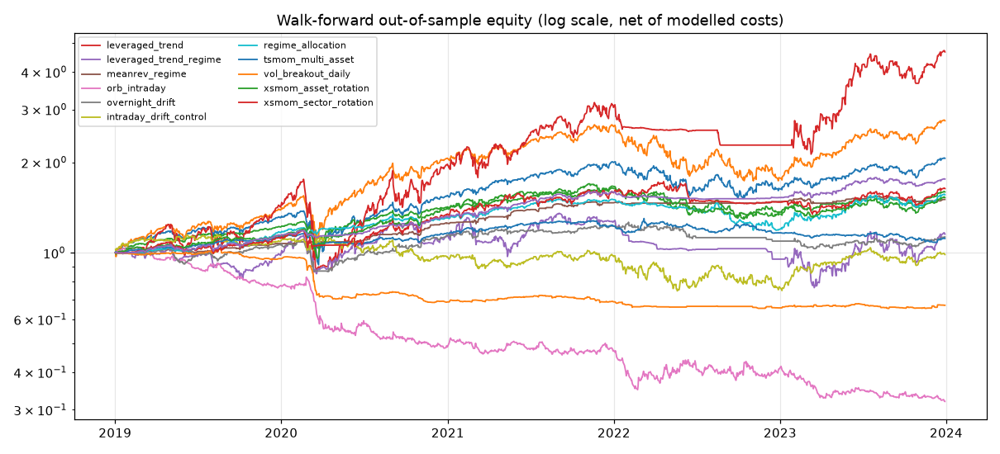

# Research report - explore stage

> **Research only - paper trading, no orders placed.** Results are historical
> simulations with modelled costs. They are not predictions and not financial
> advice. A strategy surviving every check can still fail going forward.

- generated: `2026-10-21T16:23:30.428915+00:00` - commit `5147126898`
- train **2016-01-01 -> 2021-12-31** | validation **2022-01-01 -> 2023-12-31** | test **2024-01-01 -> 2026-10-20 (LOCKED, not loaded)**
- total parameter trials run: **476** (all counted in the multiple-testing corrections)
- data feed: `sip`; costs: half-spread per ETF + 1.0bp open / 3.0bp stop slippage, margin 7.0%/yr

## Survivors (passed every pre-registered check)

**None.** No strategy passed every check.

## Validation period (out-of-sample for parameter selection)

| strategy | CAGR | avg month (geo) | Sharpe | max DD | worst month | trades |
|---|---|---|---|---|---|---|
| _buy_hold_SPY_ | 1.63% | 0.13% | 0.18 | 24.51% | -9.23% | n/a |
| _buy_hold_QQQ_ | 2.32% | 0.19% | 0.22 | 34.72% | -13.47% | n/a |
| _60_40_SPY_IEF_ | -1.31% | -0.11% | -0.04 | 20.82% | -7.38% | n/a |
| leveraged_trend | 8.91% | 0.71% | 0.45 | 35.73% | -13.64% | 27 |
| leveraged_trend_regime | 9.48% | 0.75% | 0.48 | 33.12% | -10.43% | 205 |
| meanrev_regime | 1.24% | 0.10% | 0.32 | 4.58% | -2.44% | 670 |
| orb_intraday | -13.54% | -1.20% | -0.64 | 32.56% | -9.27% | 1428 |
| overnight_drift | -0.77% | -0.06% | -0.08 | 10.12% | -4.17% | 199 |
| intraday_drift_control | 0.79% | 0.06% | 0.15 | 23.66% | -12.48% | 501 |
| regime_allocation | -1.16% | -0.10% | -0.10 | 13.65% | -4.43% | 303 |
| tsmom_multi_asset | -1.64% | -0.14% | -0.23 | 13.30% | -3.54% | 1749 |
| vol_breakout_daily | -5.06% | -0.43% | -1.01 | 10.67% | -3.43% | 489 |
| xsmom_asset_rotation | -5.69% | -0.48% | -0.40 | 22.92% | -6.72% | 271 |
| xsmom_sector_rotation | 5.85% | 0.47% | 0.61 | 11.06% | -4.32% | 374 |

## Walk-forward out-of-sample (re-selected every 6 months on the trailing 3 years)

| strategy | CAGR | avg month (geo) | Sharpe | max DD | worst month | trades |
|---|---|---|---|---|---|---|
| _buy_hold_SPY_ | 15.60% | 1.21% | 0.79 | 33.84% | -12.47% | n/a |
| _buy_hold_QQQ_ | 22.48% | 1.70% | 0.92 | 35.00% | -13.47% | n/a |
| _60_40_SPY_IEF_ | 9.79% | 0.78% | 0.82 | 21.14% | -7.38% | n/a |
| leveraged_trend | 36.12% | 2.60% | 0.97 | 50.82% | -31.90% | n/a |
| leveraged_trend_regime | 2.90% | 0.24% | 0.24 | 43.46% | -13.71% | n/a |
| meanrev_regime | 8.53% | 0.68% | 1.52 | 4.58% | -2.44% | n/a |
| orb_intraday | -20.41% | -1.88% | -1.13 | 69.28% | -27.28% | n/a |
| overnight_drift | 2.45% | 0.20% | 0.27 | 21.13% | -12.66% | n/a |
| intraday_drift_control | -0.27% | -0.02% | 0.08 | 35.25% | -12.48% | n/a |
| regime_allocation | 9.31% | 0.74% | 0.85 | 21.26% | -6.42% | n/a |
| tsmom_multi_asset | 2.21% | 0.18% | 0.35 | 16.73% | -4.50% | n/a |
| vol_breakout_daily | -7.75% | -0.67% | -1.12 | 36.45% | -19.30% | n/a |
| xsmom_asset_rotation | 8.85% | 0.71% | 0.72 | 22.65% | -6.72% | n/a |
| xsmom_sector_rotation | 10.36% | 0.82% | 0.73 | 22.11% | -11.30% | n/a |

## Robustness checks

| strategy | trials | DSR (train) | PBO | neighbour ratio | null p | 2x-cost val Sharpe | WF choice stability | survives | failed checks |
|---|---|---|---|---|---|---|---|---|---|
| leveraged_trend | 72 | 0.99 | 0.41 | 0.90 | 0.020 | 0.45 | 30% | no | validation_sharpe, enough_trades |
| leveraged_trend_regime | 36 | 0.98 | 0.93 | 0.95 | 0.160 | 0.45 | 40% | no | validation_sharpe, walkforward_oos_sharpe, pbo, null_test |
| meanrev_regime | 48 | 0.94 | 0.02 | 0.80 | 0.000 | 0.23 | 80% | no | validation_sharpe |
| orb_intraday | 72 | 0.00 | 0.00 | n/a | 0.999 | -2.30 | 40% | no | validation_sharpe, validation_cagr, walkforward_oos_sharpe, dsr_train, null_test, cost_stress_2x |
| overnight_drift | 16 | 0.91 | 0.66 | 0.77 | 0.015 | -0.56 | 30% | no | validation_sharpe, validation_cagr, walkforward_oos_sharpe, pbo, cost_stress_2x |
| intraday_drift_control | 16 | 0.09 | 0.01 | -4.72 | 0.403 | -0.23 | 70% | no | validation_sharpe, walkforward_oos_sharpe, dsr_train, null_test, cost_stress_2x, neighbourhood |
| regime_allocation | 36 | 1.00 | 0.84 | 0.93 | 0.160 | -0.15 | 40% | no | validation_sharpe, validation_cagr, pbo, null_test, cost_stress_2x |
| tsmom_multi_asset | 48 | 0.91 | 0.26 | 0.79 | 0.150 | -0.29 | 40% | no | validation_sharpe, validation_cagr, walkforward_oos_sharpe, null_test, cost_stress_2x |
| vol_breakout_daily | 24 | 0.00 | 0.32 | n/a | 0.994 | -1.97 | 40% | no | validation_sharpe, validation_cagr, walkforward_oos_sharpe, dsr_train, null_test, cost_stress_2x |
| xsmom_asset_rotation | 36 | 0.89 | 0.13 | 0.86 | 0.240 | -0.41 | 60% | no | validation_sharpe, validation_cagr, dsr_train, null_test, cost_stress_2x |
| xsmom_sector_rotation | 72 | 0.89 | 0.06 | 0.89 | 0.110 | 0.58 | 30% | no | dsr_train, null_test |

## What it would take to hit 5-8% per month (leverage on walk-forward OOS returns)

| strategy | Kelly leverage | best monthly geo at any leverage | 5%/mo: leverage | 5%/mo: hist max DD | 5%/mo: P(DD>50%) 1y | 8%/mo: leverage | 8%/mo: hist max DD |
|---|---|---|---|---|---|---|---|
| leveraged_trend | 2.41x | 3.17% | unreachable | unreachable | - | unreachable | unreachable |
| leveraged_trend_regime | 0.97x | 0.24% | unreachable | unreachable | - | unreachable | unreachable |
| meanrev_regime | 27.73x | 0.83% | unreachable | unreachable | - | unreachable | unreachable |
| orb_intraday | -6.09x | -0.91% | unreachable | unreachable | - | unreachable | unreachable |
| overnight_drift | 2.29x | 0.20% | unreachable | unreachable | - | unreachable | unreachable |
| intraday_drift_control | 0.42x | 0.03% | unreachable | unreachable | - | unreachable | unreachable |
| regime_allocation | 7.67x | 0.80% | unreachable | unreachable | - | unreachable | unreachable |
| tsmom_multi_asset | 5.03x | 0.18% | unreachable | unreachable | - | unreachable | unreachable |
| vol_breakout_daily | -16.06x | -0.33% | unreachable | unreachable | - | unreachable | unreachable |
| xsmom_asset_rotation | 5.53x | 0.72% | unreachable | unreachable | - | unreachable | unreachable |
| xsmom_sector_rotation | 4.86x | 0.88% | unreachable | unreachable | - | unreachable | unreachable |

## Combined portfolio (top walk-forward (NOT survivors))

Members: meanrev_regime, leveraged_trend, regime_allocation (causal inverse-volatility weights on walk-forward OOS returns).

| strategy | CAGR | avg month (geo) | Sharpe | max DD | worst month | trades |
|---|---|---|---|---|---|---|
| portfolio | 11.98% | 0.95% | 1.51 | 6.45% | -3.94% | n/a |

Adds value vs best single member (meanrev_regime, WF Sharpe 1.52): **no**

## Data quality

33 series loaded. Flagged (big jumps / gaps / zero volume): QLD {'first': '2016-01-04', 'last': '2026-10-20', 'days': 2715, 'missing_sessions_after_first': 0, 'max_abs_daily_return': 0.24327485380116964, 'days_abs_return_over_15pct': ['2020-03-12', '2020-03-13', '2020-03-16', '2020-03-24', '2025-04-09'], 'zero_volume_days': 0}, SLV {'first': '2016-01-04', 'last': '2026-10-20', 'days': 2715, 'missing_sessions_after_first': 0, 'max_abs_daily_return': 0.2863769762378112, 'days_abs_return_over_15pct': ['2026-01-30', '2026-02-05'], 'zero_volume_days': 0}, SSO {'first': '2016-01-04', 'last': '2026-10-20', 'days': 2715, 'missing_sessions_after_first': 0, 'max_abs_daily_return': 0.23401139137510163, 'days_abs_return_over_15pct': ['2020-03-09', '2020-03-12', '2020-03-13', '2020-03-16', '2020-03-24', '2025-04-09'], 'zero_volume_days': 0}, TQQQ {'first': '2016-01-04', 'last': '2026-10-20', 'days': 2715, 'missing_sessions_after_first': 0, 'max_abs_daily_return': 0.3525441329179646, 'days_abs_return_over_15pct': ['2018-12-26', '2020-02-27', '2020-03-09', '2020-03-10', '2020-03-12', '2020-03-13', '2020-03-16', '2020-03-17', '2020-03-24', '2020-03-26'], 'zero_volume_days': 0}, UPRO {'first': '2016-01-04', 'last': '2026-10-20', 'days': 2715, 'missing_sessions_after_first': 0, 'max_abs_daily_return': 0.3502304147465438, 'days_abs_return_over_15pct': ['2020-03-09', '2020-03-10', '2020-03-12', '2020-03-13', '2020-03-16', '2020-03-17', '2020-03-18', '2020-03-24', '2020-03-26', '2020-04-06'], 'zero_volume_days': 0}, USO {'first': '2016-01-04', 'last': '2026-10-20', 'days': 2715, 'missing_sessions_after_first': 0, 'max_abs_daily_return': 0.25458715596330284, 'days_abs_return_over_15pct': ['2020-03-09', '2020-03-18', '2020-04-02', '2020-04-03', '2020-04-21', '2020-04-27'], 'zero_volume_days': 0}, VNQ {'first': '2016-01-04', 'last': '2026-10-20', 'days': 2715, 'missing_sessions_after_first': 0, 'max_abs_daily_return': 0.1765559496936473, 'days_abs_return_over_15pct': ['2020-03-16'], 'zero_volume_days': 0}, XLE {'first': '2016-01-04', 'last': '2026-10-20', 'days': 2715, 'missing_sessions_after_first': 0, 'max_abs_daily_return': 0.20160791589363025, 'days_abs_return_over_15pct': ['2020-03-09', '2020-03-24'], 'zero_volume_days': 0}, XLF {'first': '2016-01-04', 'last': '2026-10-20', 'days': 2715, 'missing_sessions_after_first': 0, 'max_abs_daily_return': 0.17902813299232734, 'days_abs_return_over_15pct': ['2016-09-19'], 'zero_volume_days': 0}

## Per-strategy detail

### leveraged_trend (leveraged_trend)

_Hypothesis:_ Holding a real daily-reset leveraged ETF only while its underlying closes above SMA(n) (else a defensive asset) beats buy-and-hold of the leveraged ETF on risk-adjusted return and drawdown.

- selected on train: `{"lev": "QLD", "sma": 150, "filter": "band2", "defensive": "IEF"}`
- train: CAGR 43.28%, Sharpe 1.25, max DD 34.39%, trades 27, time in market 100%, cost drag 0.07%/yr
- share of trials with positive train Sharpe: 100%
- regimes (train+val, ann. return): down_highvol: 22.1%, down_lowvol: 0.0%, up_highvol: 43.9%, up_lowvol: 37.8%, warmup: 10.7%
- by year: 2016: 9.3%, 2017: 70.4%, 2018: 10.2%, 2019: 43.8%, 2020: 89.3%, 2021: 54.6%, 2022: -32.0%, 2023: 74.2%

### leveraged_trend_regime (leveraged_trend)

_Hypothesis:_ Holding the leveraged ETF only in uptrend (above SMA200) AND low-volatility (20d vol below its trailing 1y median) regimes of the underlying yields higher Sharpe than trend-only or buy-and-hold leverage.

- selected on train: `{"lev": "QLD", "mapping": "lev_unlev_unlev", "defensive": "IEF"}`
- train: CAGR 23.37%, Sharpe 1.03, max DD 25.57%, trades 205, time in market 82%, cost drag 0.59%/yr
- share of trials with positive train Sharpe: 100%
- regimes (train+val, ann. return): down_highvol: 6.0%, down_lowvol: 48.3%, up_highvol: 15.8%, up_lowvol: 30.5%, warmup: 0.0%
- by year: 2016: 0.0%, 2017: 32.2%, 2018: 7.4%, 2019: 27.4%, 2020: 44.8%, 2021: 34.5%, 2022: -30.8%, 2023: 73.0%

### meanrev_regime (mean_reversion)

_Hypothesis:_ For SPY/QQQ/IWM/DIA trading above their 200-day SMA, buying the next open after a short-term oversold close (RSI(2), IBS or consecutive down closes) and selling on the bounce earns a positive after-cost return per unit of exposure (Sharpe > 0) out of sample.

- selected on train: `{"signal": "ibs", "threshold": "strict", "exit_rule": "rsi2", "max_hold": 5, "vol_filter": true, "allow_short": false, "gross": 1.0, "band": 0.02}`
- train: CAGR 8.29%, Sharpe 1.70, max DD 4.19%, trades 670, time in market 25%, cost drag 0.41%/yr
- share of trials with positive train Sharpe: 100%
- regimes (train+val, ann. return): down_highvol: 4.3%, down_lowvol: 17.8%, up_highvol: 11.1%, up_lowvol: 5.1%, warmup: 0.0%
- by year: 2016: 0.0%, 2017: 6.8%, 2018: 1.6%, 2019: 8.8%, 2020: 16.9%, 2021: 16.9%, 2022: 0.9%, 2023: 1.6%

### orb_intraday (opening_range_breakout)

_Hypothesis:_ A first-touch stop entry at the edge of the first 5/15/30-minute range of SPY/QQQ/IWM, with a stop at the opposite side (or half the range) and exit by target or the session close, earns positive net returns after costs.

- selected on train: `{"or_minutes": 5, "stop_frac": 1.0, "target_r": 0.0, "width_filter": false, "trend_filter": false, "risk_pct": 0.01, "max_size": 2.0}`
- train: CAGR -18.34%, Sharpe -1.26, max DD 71.77%, trades 4178, time in market 99%, cost drag 32.75%/yr
- share of trials with positive train Sharpe: 0%
- regimes (train+val, ann. return): down_highvol: -28.1%, down_lowvol: -41.6%, up_highvol: -23.8%, up_lowvol: -9.6%, warmup: -18.7%
- by year: 2016: -14.8%, 2017: -26.2%, 2018: -7.0%, 2019: -11.6%, 2020: -37.6%, 2021: -8.1%, 2022: -2.7%, 2023: -23.0%

### overnight_drift (overnight_intraday_decomposition)

_Hypothesis:_ Holding SPY/QQQ/IWM from the close to the next open earns a positive mean return that survives close+open trading costs (overnight premium).

- selected on train: `{"universe": "QQQ", "trend_filter": "sma200", "skip_weekday": true, "size_mult": 1.0}`
- train: CAGR 7.76%, Sharpe 0.90, max DD 12.73%, trades 972, time in market 64%, cost drag 5.32%/yr
- share of trials with positive train Sharpe: 100%
- regimes (train+val, ann. return): down_highvol: 2.3%, down_lowvol: 0.3%, up_highvol: 15.6%, up_lowvol: 2.7%, warmup: 0.0%
- by year: 2016: -1.0%, 2017: 7.0%, 2018: 2.9%, 2019: 8.3%, 2020: 23.6%, 2021: 7.3%, 2022: -4.6%, 2023: 3.3%

### intraday_drift_control (overnight_intraday_decomposition)

_Hypothesis:_ Control: holding SPY/QQQ/IWM from the open to the same-day close earns a mean return no greater than zero net of costs.

- selected on train: `{"universe": "QQQ", "trend_filter": "none", "skip_weekday": false, "size_mult": 1.0}`
- train: CAGR -0.49%, Sharpe 0.05, max DD 29.71%, trades 1510, time in market 100%, cost drag 8.26%/yr
- share of trials with positive train Sharpe: 6%
- regimes (train+val, ann. return): down_highvol: 22.7%, down_lowvol: -6.7%, up_highvol: -13.8%, up_lowvol: 1.9%, warmup: 9.4%
- by year: 2016: -1.2%, 2017: 1.6%, 2018: -20.7%, 2019: 10.7%, 2020: 9.9%, 2021: 0.2%, 2022: -20.7%, 2023: 28.0%

### regime_allocation (regime_allocation)

_Hypothesis:_ Allocating SPY/QQQ/TLT/IEF/GLD/SHY by a causal regime (SPY vs SMA, SPY vol vs 1y median, bond trend) yields a higher Sharpe and smaller max drawdown than a static 60/40 SPY/IEF mix.

- selected on train: `{"trend_sma": 100, "bond_sma": 50, "vol_filter": true, "alloc_map": "defensive", "min_hold": 5, "band": 0.05}`
- train: CAGR 8.42%, Sharpe 1.37, max DD 6.70%, trades 303, time in market 82%, cost drag 0.19%/yr
- share of trials with positive train Sharpe: 100%
- regimes (train+val, ann. return): down_highvol: 1.0%, down_lowvol: 2.2%, up_highvol: 5.5%, up_lowvol: 8.9%, warmup: 0.0%
- by year: 2016: 0.0%, 2017: 10.4%, 2018: 0.1%, 2019: 9.2%, 2020: 17.4%, 2021: 14.6%, 2022: -13.1%, 2023: 12.4%

### tsmom_multi_asset (trend_following)

_Hypothesis:_ Own-asset trailing return sign predicts next-period return across asset classes (vol-targeted).

- selected on train: `{"lookback": 63, "allow_short": false, "target_vol": 0.1, "rebalance": "W", "confirm_sma": false, "max_gross": 1.0}`
- train: CAGR 6.64%, Sharpe 1.20, max DD 10.21%, trades 1749, time in market 95%, cost drag 0.32%/yr
- share of trials with positive train Sharpe: 100%
- regimes (train+val, ann. return): down_highvol: -4.0%, down_lowvol: 4.2%, up_highvol: 10.1%, up_lowvol: 3.8%, warmup: 7.9%
- by year: 2016: 4.7%, 2017: 10.1%, 2018: 2.5%, 2019: 12.7%, 2020: 3.3%, 2021: 7.0%, 2022: -7.0%, 2023: 4.1%

### vol_breakout_daily (volatility_breakout)

_Hypothesis:_ A move beyond open +/- k*(prior range or ATR through yesterday) continues to the close, so a stop entry held to the close is profitable net of costs.

- selected on train: `{"k": 0.5, "measure": "atr", "atr_n": 10, "allow_short": false, "trend_sma": 200, "max_gross": 2.0}`
- train: CAGR -4.19%, Sharpe -0.80, max DD 24.09%, trades 1987, time in market 59%, cost drag 6.49%/yr
- share of trials with positive train Sharpe: 0%
- regimes (train+val, ann. return): down_highvol: -0.3%, down_lowvol: 9.6%, up_highvol: -12.0%, up_lowvol: -2.7%, warmup: 0.0%
- by year: 2016: -1.5%, 2017: -3.9%, 2018: -5.9%, 2019: -4.5%, 2020: -9.2%, 2021: 0.1%, 2022: -4.5%, 2023: -5.5%

### xsmom_asset_rotation (cross_sectional_momentum)

_Hypothesis:_ Holding the top-N of 12 asset-class ETFs by trailing return (equal weight, rebalanced weekly/monthly, slots that fail to beat SHY's own trailing return parked in SHY) earns a positive after-cost Sharpe that a random re-timing of the same holdings does not, because relative and absolute momentum persist across asset classes.

- selected on train: `{"lookback": "blend_1_3_6_12", "top_n": 6, "rebalance": "M", "abs_filter": false, "band": 0.01}`
- train: CAGR 12.53%, Sharpe 1.19, max DD 14.85%, trades 271, time in market 83%, cost drag 0.12%/yr
- share of trials with positive train Sharpe: 100%
- regimes (train+val, ann. return): down_highvol: 2.2%, down_lowvol: 23.9%, up_highvol: 13.3%, up_lowvol: 7.6%, warmup: 0.0%
- by year: 2016: 0.0%, 2017: 19.9%, 2018: -1.5%, 2019: 13.9%, 2020: 27.4%, 2021: 18.5%, 2022: -19.6%, 2023: 10.8%

### xsmom_sector_rotation (cross_sectional_momentum)

_Hypothesis:_ Holding the top-N of the 9 SPDR sector ETFs by trailing return (equal weight, rebalanced weekly/monthly, optional SHY switch for sectors that fail to beat SHY and for the whole book when SPY is below its 200-day SMA) earns a positive after-cost Sharpe that a random re-timing of the same holdings does not, because industry momentum persists at the sector level.

- selected on train: `{"lookback": "blend_1_3_6_12", "top_n": 4, "rebalance": "W", "abs_filter": false, "market_filter": true, "band": 0.01}`
- train: CAGR 13.07%, Sharpe 1.01, max DD 14.03%, trades 374, time in market 83%, cost drag 0.31%/yr
- share of trials with positive train Sharpe: 100%
- regimes (train+val, ann. return): down_highvol: 6.5%, down_lowvol: 2.0%, up_highvol: 19.1%, up_lowvol: 10.9%, warmup: 0.0%
- by year: 2016: 0.0%, 2017: 18.7%, 2018: 0.7%, 2019: 12.3%, 2020: 20.4%, 2021: 29.2%, 2022: 0.9%, 2023: 11.0%

